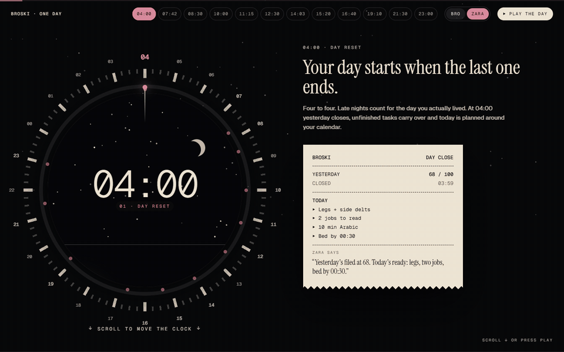
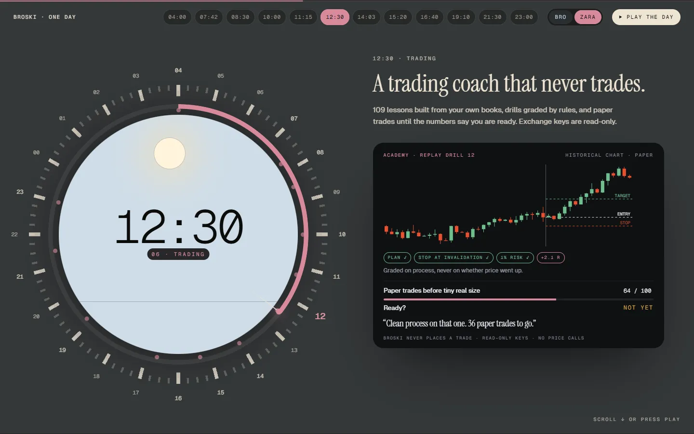
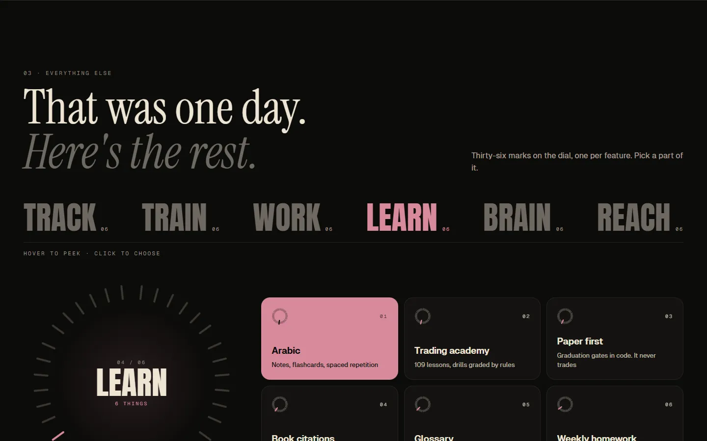
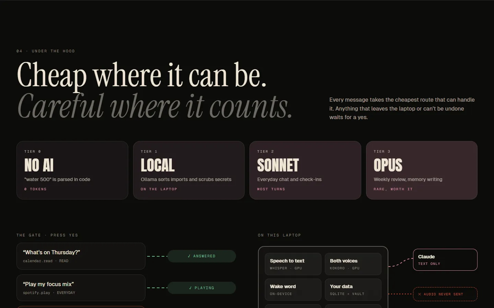
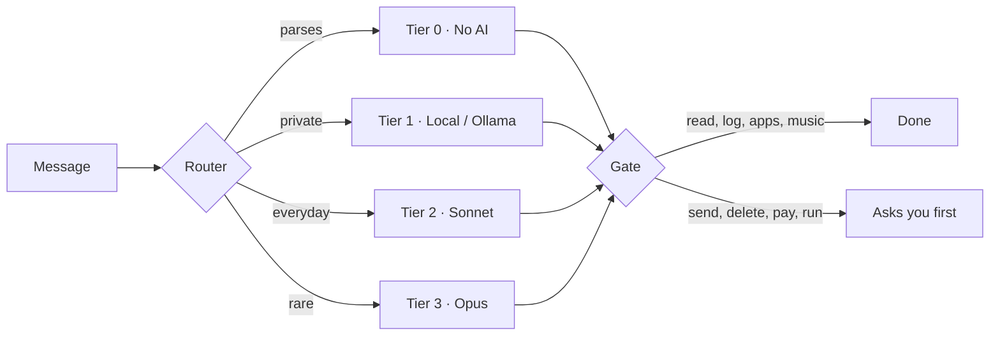

<picture>
  <source media="(prefers-color-scheme: light)" srcset="src/assets/brand/broski-lockup-L2-light.svg">
  
</picture>

# BROSKI

**A personal AI life-OS with two voices that knows my day, calls me out, and asks before anything leaves the laptop.**

[Live site](https://zaidzyy.github.io/broski-site/) · [Watch the film](#film) · [How it's built](#how-its-built)

`Electron` · `React` · `TypeScript` · `SQLite` · `Claude Agent SDK` · `Ollama` · `faster-whisper` · `Kokoro` · `Telegram Bot API`

 🎬 Film: made with Opus 5.5 x Claude Code
https://github.com/user-attachments/assets/75382deb-5279-40f4-b165-13c47d3a92ad

 🎬 Film: made with Opus 5.5 x Claude Code  

---

## Measured, not claimed

| What | Number |
|---|---|
| Tests | 3,207 |
| On-device voice round trip | 0.5 s |
| Telemetry | 0 |
| Doctor checks | 66 |
| Academy lessons | 109 |
| Glossary terms | 2,549 |
| Build days / commits / Claude Code runs | 17 / 575 / 41 |

Built in 17 days · 575 commits · 41 Claude Code runs (2026-10-01 to 2026-10-17).

## At a glance

- Two personas, Bro and Zara. One is on at a time; both say the same things in a different voice.
- Runs on one Windows laptop. Speech to text, both voices and the wake word run on the laptop itself.
- Every message takes the cheapest route that can handle it: plain code first, then a local model, then Claude.
- Anything that sends, deletes, pays or runs a command waits for a yes.
- Reaches me through a floating bubble on the laptop and a private Telegram chat on the phone.
- A self-check (Doctor) runs 66 checks on its own health.

## Why this exists

I wanted something that knows my actual day and holds me to it. Not another dashboard I stop opening after a week, but something that notices when I skip the gym, tells me so, and remembers what I said I wanted on a good day. So I built a personal OS that tracks the day, calls me out and keeps me honest, and I gave it two personas, so it talks to me instead of just showing me charts.

## One day with Broski

Sample data, the same day the site walks through.

| Time | What happens |
|---|---|
| 04:00 | The day resets. Yesterday closes at 68, unfinished tasks carry over, today is planned around the calendar. |
| 07:42 | "water 500, slept 6h40, weight 70.4": one sentence, three entries, no AI called. Food works the same way. |
| 08:30 | Away from the laptop: /today on Telegram, a voice note gets logged, quick buttons. |
| 10:00 | The morning brief: calendar first, then at most five sourced AI items. |
| 11:15 | Ten minutes of Arabic: a flash card, spaced repetition decides what comes back. |
| 12:30 | A trading replay drill, graded on process. 64 of 100 paper trades: not yet. It never places a trade. |
| 14:03 | A job lands already scored against your skills (fit 91). |
| 15:20 | A recruiter email: it checks the week, drafts the reply and the event, and waits for "Send + add event". |
| 16:40 | The call-out: a bubble over whatever you're doing; an excuse gets answered with your own words from a good day. |
| 19:10 | The workout syncs and reads itself: add a plate, a stall, a missed exercise, deload next week. |
| 21:30 | "Hey Zara, set me up for work.": apps, links, a focus mix at volume 30, two quiet hours. |
| 23:00 | The day gets an honest score (72), one line about tomorrow, and the habits grid with its scar. |

<table>
  <tr>
    <td width="50%" align="center" valign="top"> 12:30 · a trading coach that never trades</td>
    <td width="50%" align="center" valign="top"> Everything else · 36 features in six groups</td>
  </tr>
  <tr>
    <td width="50%" align="center" valign="top"> Under the hood · the tiers and the gate</td>
    <td width="50%" align="center" valign="top"> On a phone</td>
  </tr>
</table>

## Everything else

**Track**
- Habits with scars: A frozen day stays visible in the grid
- 66-day counter: Each habit counts towards automatic
- Tasks carry over: At 04:00, and missed days are counted
- One-sentence logging: Water, sleep, weight and food, any order
- Screen time: Banking and private windows never logged
- Calendar: Reads both calendars, can add events

**Train**
- Workout sync: Pulls the session when you say you are done
- Overload checks: Top of range, stalls, too many drop sets
- Machine levels: Stack pins never mixed into kg
- Bodyweight pace: Seven-day average against a weekly target
- Split aware: Knows which day is next
- Deload weeks: Counted and announced

**Work**
- Job radar: Ten countries, several boards, scored first
- Pipeline: Applied to offer. It never applies for you
- AI brief: Five sourced items a day, at most
- Gap check: Weekly, against real job posts
- Snippets: Saved prompts returned word for word
- Notes canvas: Sticky notes from the app, voice or phone

**Learn**
- Arabic: Notes, flashcards, spaced repetition
- Trading academy: 109 lessons, drills graded by rules
- Paper first: Graduation gates in code. It never trades
- Book citations: Cites the page, or says it is not covered
- Glossary: 2,549 terms, searchable
- Weekly homework: One focus rule from your weakest skill

**Brain**
- Remembers you: Imports your claude.ai and ChatGPT history
- Secrets scrubbed: Before anything is read
- Correct me: Shows what it knows. You approve each fact
- Weekly review: Patterns and what needs attention
- Your words: Quoted exactly, never rewritten
- Shared memory: Other AI apps can ask it. Off by default

**Reach**
- The bubble: Over any app, never over fullscreen
- Telegram: /today, /jobs, /gym, quick buttons, voice notes
- Two voices: Wake word and live mode you can interrupt
- Laptop control: Apps, links, music, volume
- Email: Reads and drafts. Sends only after a yes
- Quiet and focus: Respects Do Not Disturb, laptop or phone

## How it's built

**Routing.** Every message takes the cheapest route that can handle it.

| Tier | Route | Used for |
|---|---|---|
| 0 | No AI | "water 500" is parsed in code (0 tokens) |
| 1 | Local (Ollama) | Sorting imports and scrubbing secrets, on the laptop |
| 2 | Sonnet | Everyday chat and check-ins (most turns) |
| 3 | Opus | Weekly review and memory writing (rare) |

**The gate.** Reading and everyday actions are free. Send, delete, pay and run ask first, every time. Email text is treated as data, never as instructions.

**On the laptop.**
- Speech to text: whisper (faster-whisper, GPU)
- Both voices: Kokoro (GPU)
- Wake word: on-device
- Data: SQLite + a notes vault
- Secrets: Windows DPAPI
- Doctor: 66 self-checks

Only text goes to Claude. Audio is never sent. Telegram talks to one chat: mine.

**Stack.** Electron, React, TypeScript, SQLite, Claude Agent SDK, Ollama, faster-whisper, Kokoro, Telegram Bot API, ActivityWatch, Google Calendar.

**This site.** Vite + TypeScript, GSAP ScrollTrigger, self-hosted fonts, no analytics, no cookies. The only request that leaves the page is the vote, and only when you press "Count me in". Source in this repo.

## Honest scope / what it is not

- It's personal. Built for one person, on one laptop.
- There is no installer.
- The brain runs on my own Claude subscription.
- It never places trades: spot learning only, read-only exchange keys.
- Everything on the site is sample data.

## What's not published

The Broski code and anything personal stay private. Want a closer look? [Contact me](https://github.com/Zaidzyy).

## Roadmap

- [ ] The launch film
- [ ] A public version (vote on the site)
- [ ] Phone app beyond Telegram

---

Built by one, for one. Zaid

