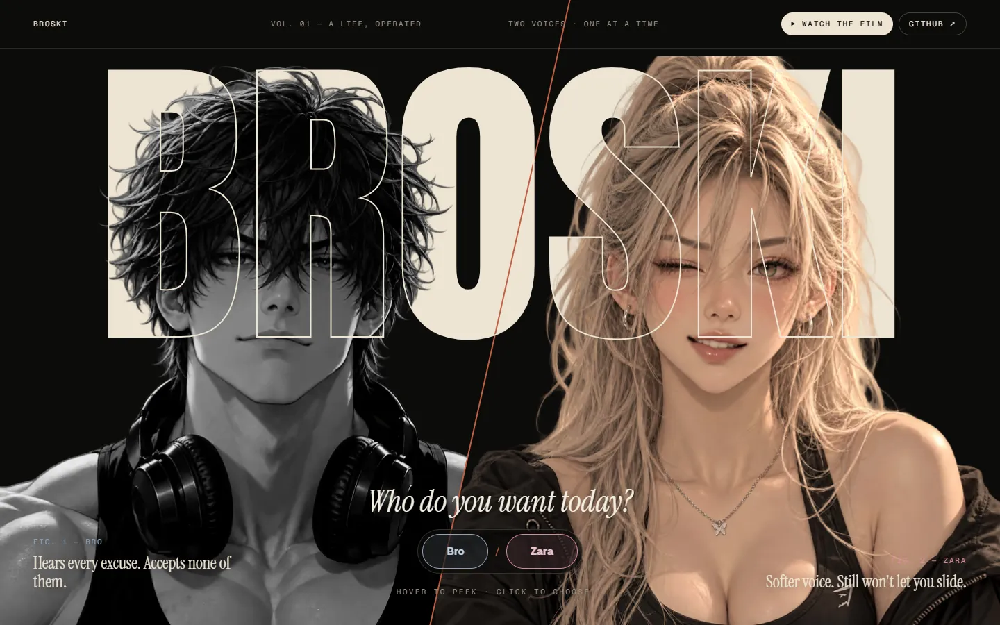
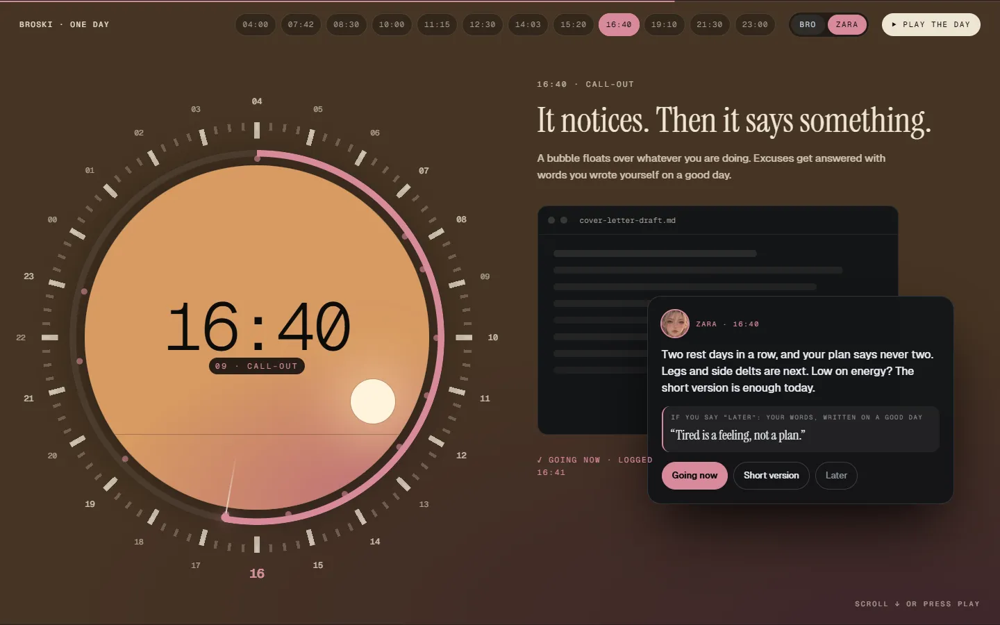
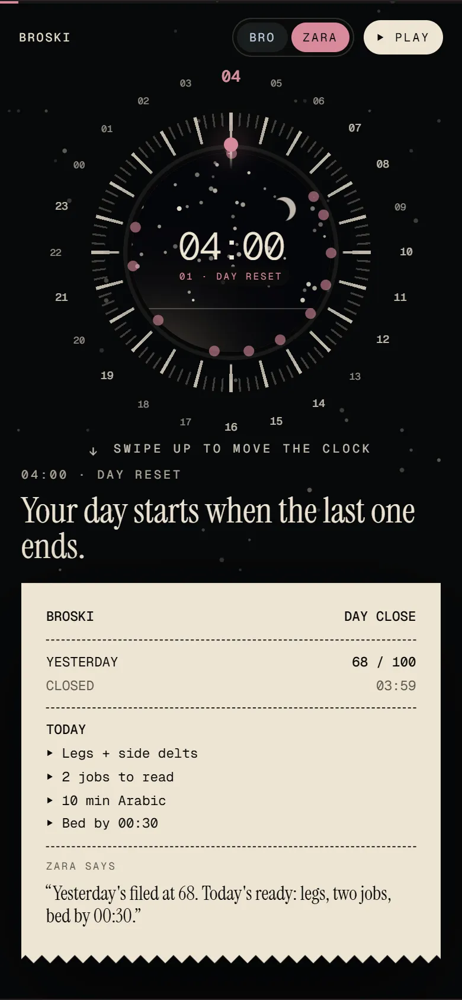

# broski-site build prompt v2: report

The Broski landing page (GitHub Pages) and the public README, built from the decided design (`Mix.dc.html`, G6, G7, J1 Day, DayPhone). Details, assumptions B1–B26 and the review results are in [BUILD-LOG.md](BUILD-LOG.md).

## What was built

- **01 Hero (G6 / G7).**
  - The intro runs in order: letters rise, the slash grows, the faces wipe in, the header fades.
  - Hover peek (pointer only, ~120 ms intent), click to pick, click again for both.
  - The accent recolours the page: steel for Bro, rose for Zara.
  - On a phone the chooser is a bottom sheet.
- **02 The day (J1, 12 scenes).**
  - A pinned stage (~12 screens of scroll) with the 24-hour dial, the vivid sky inside it, the sun and moon, and a dimmed sky behind.
  - Each scene's widgets animate once on entry.
  - The ending: the window closes, the ticks fall away, the arc shrinks to 72 %, and the 72 appears.
  - Top bar: hour chips, the Bro/Zara switch, ▶ Play (about 25 s, press again to stop) and a progress line.
  - Phone: a small pinned dial, with the scene below at full width.
  - Reduced motion (and no JS): twelve still sections.
- **03 Everything else.** Six Anton word tabs (an ARIA tablist with arrow keys and Home/End), the 36-mark ring and the bento. Learn is open first.
- **04 Under the hood.**
  - Tier cards.
  - The live gate: Yes / No / Try again.
  - The laptop drawing with its link-outs.
  - Stack chips.
- **05 Yours?** The "Yet?" heading, the links, and the vote card (a radio group, optional email, "Count me in" disabled until a pick, and a thank-you state).
- **Footer.** The proof line from `facts.json`.
- **README.md.** Generated from `docs/README.template.md` + `src/data/facts.json` + `src/data/features.ts` (`npm run readme`).
- **Deploy.** `.github/workflows/deploy.yml` (written, not run). The base path comes from `src/config.ts` / `BASE_PATH`.

## Screenshots

- **Desktop:**
  - Hero: [both](screens/desktop-01-hero.webp) · [Bro](screens/desktop-01-hero-bro.webp) · [Zara](screens/desktop-01-hero-zara.webp)
  - [Day intro](screens/desktop-02-day-intro.webp)
  - Day scenes 1–12: [01](screens/desktop-day-01.webp) [02](screens/desktop-day-02.webp) [03](screens/desktop-day-03.webp) [04](screens/desktop-day-04.webp) [05](screens/desktop-day-05.webp) [06](screens/desktop-day-06.webp) [07](screens/desktop-day-07.webp) [08](screens/desktop-day-08.webp) [09](screens/desktop-day-09.webp) [10](screens/desktop-day-10.webp) [11](screens/desktop-day-11.webp) [12](screens/desktop-day-12.webp) · [end (72)](screens/desktop-day-13-end.webp)
  - Sections: [03](screens/desktop-03-rest.webp) · [04](screens/desktop-04-hood.webp) · [05](screens/desktop-05-yours.webp) · [footer](screens/desktop-06-footer.webp)
- **Phone (390×844):** the same set with the `phone-` prefix in [screens/](screens/).
- **Reduced motion:** [the still day](screens/reduced-motion-day.webp)
- **Phone hero at the edge widths:** [360 px](screens/phone-360-01-hero.webp) · [430 px](screens/phone-430-01-hero.webp)

## The facts

`src/data/facts.json` holds exactly the final values Zaid gave after the build. Nothing was counted or looked up: 3,207 tests, 0.5 s on-device voice, 0 telemetry, 66 Doctor checks, 109 lessons, 2,549 glossary terms, 2026-10-01 → 2026-10-17, 17 days, 575 commits, 41 Claude Code runs. Every number on the site and in the README is read from that file (the lesson and glossary counts in the day and the bento included), so they can't drift.

## Tests and Lighthouse

- **Playwright:** 36 passing.
  - Load with no console errors and no third-party requests.
  - CSP and meta present; no cookies or storage written.
  - Persona recolouring and hover peek.
  - Every scene and its dial digits; the ending's 72; hour chips; Play/stop; the intro pill.
  - Reduced motion; phone (no horizontal scroll, pinned dial, every scene reachable); short windows; no JS.
  - Tabs by keyboard; the gate; the film's "coming soon"; the skip link.
  - Vote: disabled until a pick; an empty endpoint sends nothing; a mocked endpoint receives exactly `{choice}` / `{choice, email}`; a bad email is caught.
  - Regression tests for the review findings.
- **Lighthouse:**
  - Desktop: 100 / 100 / 100 / 100.
  - Mobile: 92 / 100 / 100 / 100 (Performance / Accessibility / Best Practices / SEO).

## What Zaid does next

1. Create the public repo `broski-site` on GitHub.
2. ~~Optional, before the first push: switch the commit email to the GitHub noreply address.~~ **Done:** this repo uses `Zaidzyy <86546939+Zaidzyy@users.noreply.github.com>` (repo-local config) and every commit was re-authored to it.
3. Push.
4. Settings → Pages → Source: **GitHub Actions**.
5. Create a free Formspree form (or Tally) with the fields `choice` + `email`. Paste its endpoint into `VOTE_ENDPOINT` in `src/config.ts` and push; the CSP picks up its origin automatically. Until then the vote card thanks people and sends nothing.
6. Later, set `FILM_URL` in `src/config.ts` and replace the film line in `docs/README.template.md`, then run `npm run readme`.
